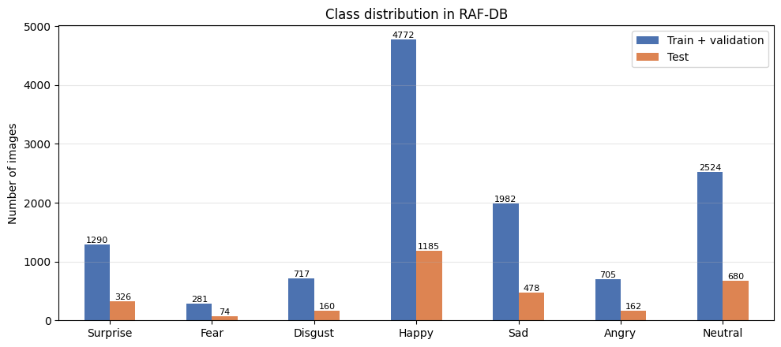
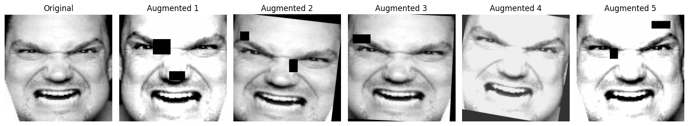
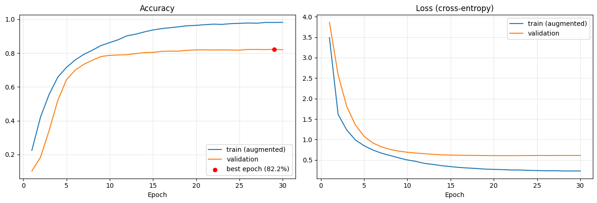
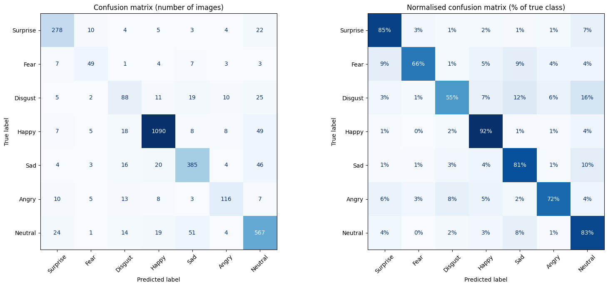
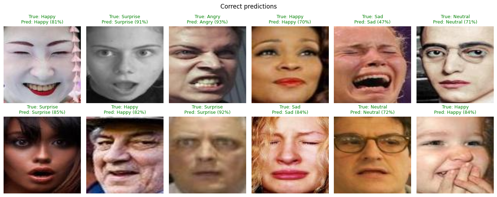
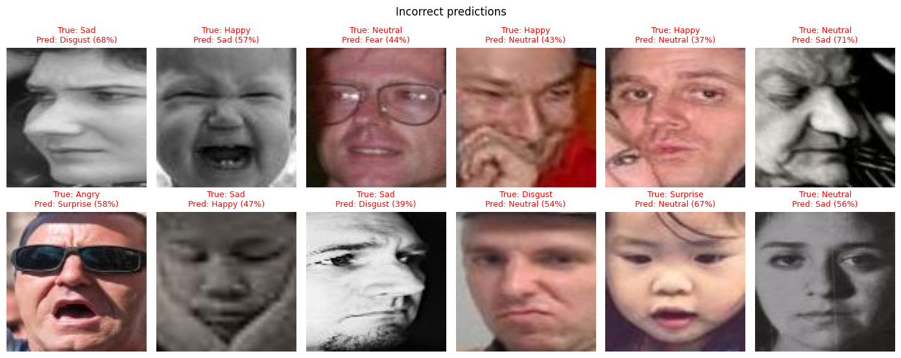

# Reconnaissance des émotions faciales sur RAF-DB

[](https://colab.research.google.com/github/mifolotech/rafdb-emotion-recognition/blob/main/RAFDB_Emotion_Recognition.ipynb)


[English](README.md) | **Français**

Classification d'expressions faciales réelles en **7 émotions** avec un **EfficientNet-B2** pré-entraîné sur ImageNet et affiné (*fine-tuning*) sur le dataset RAF-DB.

**Accuracy sur le test : 83,95 %** · F1-score macro : 0,765 · F1-score pondéré : 0,840

> Projet réalisé dans le cadre du cours de Machine Learning de la Licence en Systèmes Informatiques et Logiciels (SIL), Université Jésuite d'Abidjan (CERAP), Côte d'Ivoire.

---

## Sommaire
1. [Problème](#1-problème)
2. [Dataset](#2-dataset)
3. [Prétraitement](#3-prétraitement)
4. [Architecture du modèle](#4-architecture-du-modèle)
5. [Entraînement et hyperparamètres](#5-entraînement-et-hyperparamètres)
6. [Résultats](#6-résultats)
7. [Analyse des erreurs](#7-analyse-des-erreurs)
8. [Limites](#8-limites)
9. [Exécution](#9-exécution)
10. [Structure du dépôt](#10-structure-du-dépôt)
11. [Ce que j'ai appris](#11-ce-que-jai-appris)
12. [Références](#12-références)

---

## 1. Problème

Reconnaître les émotions à partir des expressions du visage est une brique de base pour l'interaction homme-machine, les technologies d'assistance et l'informatique affective.

**Tâche :** à partir d'une **image couleur** alignée d'un visage, prédire l'une des 7 émotions : *Surprise, Peur (Fear), Dégoût (Disgust), Joie (Happy), Tristesse (Sad), Colère (Angry), Neutre (Neutral)*.

La tâche est difficile car les photos sont prises « dans la nature » (âges, poses de la tête, éclairages variés, lunettes, mains devant le visage) et certaines émotions se ressemblent beaucoup (par exemple *Fear* et *Surprise*).

## 2. Dataset

**RAF-DB** (Real-world Affective Faces Database, Li et al., 2017) : images de visages collectées sur Internet, chacune annotée par environ 40 personnes. Le sous-ensemble des émotions de base est utilisé, avec sa séparation officielle train/test.

| Partie | Images | Utilisation |
|---|---|---|
| Train | 11 043 | Entraînement (90 % du dossier officiel `train/`) |
| Validation | 1 228 | Choix du modèle et early stopping (10 %, stratifié) |
| Test | 3 065 | Évaluation finale uniquement (dossier officiel `test/`) |

Le dataset est **déséquilibré** : *Happy* compte 4 772 images d'entraînement, *Fear* seulement 281.



Le dataset n'est pas inclus dans ce dépôt : RAF-DB est distribué par ses auteurs (Pattern Recognition & Intelligent System Laboratory, Beijing University of Posts and Telecommunications) **uniquement pour la recherche non commerciale**. La page officielle du projet n'est plus en ligne ; l'adresse de contact indiquée dans l'article est `whdeng@bupt.edu.cn` (voir [Exécution](#9-exécution)).

## 3. Prétraitement

1. Les images sont lues en **RVB** et **redimensionnées** de 100×100 à 224×224 pixels.
2. **Normalisation** avec la moyenne et l'écart-type d'ImageNet, comme l'attend le réseau pré-entraîné.
3. **Augmentation de données** (entraînement uniquement) : recadrage aléatoire, miroir horizontal, petites rotations et translations, variations de couleur, passage occasionnel en niveaux de gris et **random erasing** (rectangles noirs qui cachent une partie du visage).



## 4. Architecture du modèle

Apprentissage par transfert à partir d'un **EfficientNet-B2** pré-entraîné sur ImageNet (bibliothèque `timm`) :

```
Entrée 224×224×3
 → EfficientNet-B2 (poids ImageNet), stochastic depth 0,2
 → Global average pooling (1408 caractéristiques)
 → Dropout 0,3
 → Linéaire 1408 → 7
```

EfficientNet augmente ensemble la profondeur, la largeur et la résolution d'entrée du réseau, ce qui donne une bonne précision pour sa taille (7,7 millions de paramètres).

## 5. Entraînement et hyperparamètres

Tout le réseau est affiné, avec **deux learning rates** : le nouveau classifieur apprend vite, tandis que le réseau pré-entraîné n'est ajusté que doucement.

Techniques de régularisation utilisées pour limiter le surapprentissage :
- **Random erasing** : cache des rectangles aléatoires du visage.
- **Label smoothing** : adoucit les cibles pour que le modèle ne devienne pas trop sûr de lui.
- **Perte pondérée par classe** : les classes rares ont un poids plus élevé, $\sqrt{N / (K \cdot n_c)}$.
- **Dropout et stochastic depth** : désactivent au hasard des neurones et des blocs entiers pendant l'entraînement.
- **EMA des poids** : la validation et les prédictions utilisent une moyenne mobile des poids.
- **Early stopping** : l'entraînement s'arrête si l'accuracy de validation ne progresse plus pendant 7 époques.

| Hyperparamètre | Valeur |
|---|---|
| Taille d'entrée | 224×224×3 |
| Taille de batch | 64 |
| Époques | 30 (early stopping, patience 7) |
| Optimiseur | AdamW, weight decay = 0,05 |
| Learning rate | réseau pré-entraîné 2e-4, classifieur 1e-3 |
| Planification du learning rate | 2 époques de montée linéaire, puis décroissance cosinus jusqu'à 1 % |
| Random erasing | probabilité 0,5, 1 à 3 rectangles de 16 à 40 px |
| Label smoothing | 0,1 |
| Dropout / stochastic depth | 0,3 / 0,2 |
| Décroissance EMA | 0,998 |
| Choix du modèle | meilleure accuracy de validation (époque 29) |
| Test-time augmentation | 2 vues (originale, miroir) |
| Précision | mixed float16, GPU T4 de Google Colab (environ 1 minute par époque) |

## 6. Résultats

### Global

| Métrique | Jeu de test |
|---|---|
| **Accuracy** | **83,95 %** |
| Accuracy sans test-time augmentation | 83,69 % |
| F1-score macro | 0,765 |
| F1-score pondéré | 0,840 |

### Par classe

| Émotion | Précision | Rappel | F1-score | Images de test |
|---|---|---|---|---|
| Surprise | 0,830 | 0,853 | 0,841 | 326 |
| Fear | 0,653 | 0,662 | 0,658 | 74 |
| Disgust | 0,571 | 0,550 | 0,561 | 160 |
| Happy | 0,942 | 0,920 | 0,931 | 1 185 |
| Sad | 0,809 | 0,805 | 0,807 | 478 |
| Angry | 0,779 | 0,716 | 0,746 | 162 |
| Neutral | 0,789 | 0,834 | 0,811 | 680 |

*Happy* et *Surprise* sont les mieux reconnues : leurs expressions sont très marquées (sourire ; bouche ouverte et sourcils levés). *Disgust* est la classe la plus difficile : elle a peu d'exemples et s'exprime souvent de façon subtile.

### Courbes d'apprentissage



- La courbe d'entraînement est calculée sur des images augmentées avec le dropout actif, la courbe de validation sur des images réelles avec les poids EMA.
- La **loss de validation diminue puis reste stable (environ 0,61)** : elle ne remonte pas, donc le modèle ne devient pas trop sûr de lui.
- L'accuracy de validation atteint environ 80 % à l'époque 15, puis se stabilise autour de 82 %, tandis que l'accuracy d'entraînement continue de monter vers 98 %. L'**écart d'environ 16 points** montre que le modèle mémorise encore une partie des images d'entraînement (**surapprentissage**). Ce sont les poids de la meilleure époque (29, accuracy de validation 82,2 %) qui sont conservés.

### Matrice de confusion



### Comparaison avec une première version

Une première version de ce projet (cross-entropy simple, augmentation légère, 15 époques) atteignait **84,08 %** sur le test, avec un écart semblable entre entraînement et validation et une loss de validation qui remontait après l'époque 3. Les techniques de régularisation de cette version **n'ont pas amélioré l'accuracy** (83,95 %) et **n'ont pas réduit l'écart d'accuracy**, mais elles ont empêché la loss de validation de remonter. Cette version ajoute aussi le F1-score macro, un pipeline reproductible et une analyse des erreurs.

## 7. Analyse des erreurs

Confusions les plus fréquentes sur le jeu de test :

| Émotion réelle | Prédite comme | Taux | Images |
|---|---|---|---|
| Disgust | Neutral | 15,6 % | 25 |
| Disgust | Sad | 11,9 % | 19 |
| Sad | Neutral | 9,6 % | 46 |
| Fear | Surprise | 9,5 % | 7 |
| Fear | Sad | 9,5 % | 7 |

*Neutral* attire la plupart des erreurs : un léger *Disgust* ou une légère tristesse est souvent lu comme une absence d'émotion. *Fear* et *Surprise* ont toutes deux les yeux grands ouverts et la bouche ouverte.

**Prédictions correctes**



**Prédictions incorrectes**



Beaucoup d'erreurs portent sur des images difficiles : occlusions (lunettes de soleil, mains), fortes rotations de la tête, photos sombres ou en noir et blanc, et visages ambigus même pour un humain.

## 8. Limites

- **Surapprentissage** : un écart d'environ 16 points subsiste entre l'accuracy d'entraînement et celle de validation. Ajouter de la régularisation ne l'a pas réduit.
- **Déséquilibre des classes** : *Fear* n'a que 281 images d'entraînement et 74 images de test, donc ses résultats sont moins fiables que ceux des grandes classes.
- **Émotions proches** : *Disgust*, *Sad* et *Neutral*, ainsi que *Fear* et *Surprise*, sont souvent confondues.
- **Annotations ambiguës** : les vrais visages mélangent souvent plusieurs émotions ; même les annotateurs humains ne sont pas toujours d'accord.
- **Visages alignés uniquement** : le modèle n'a pas de détecteur de visage ; une photo doit d'abord être recadrée et alignée autour du visage.
- **Un seul entraînement** : les résultats viennent d'une seule exécution avec une seed fixe. La variance entre plusieurs exécutions n'a pas été mesurée.
- **Images fixes uniquement** : le modèle n'a pas été testé sur de la vidéo en temps réel ni sur des visages d'autres datasets, donc sa généralisation à d'autres conditions est inconnue.
- **Note éthique** : une expression faciale ne reflète pas toujours l'état émotionnel réel d'une personne, et les performances peuvent varier selon les populations. Ce modèle est un projet pédagogique et ne doit pas servir à prendre des décisions concernant des personnes.

**Améliorations possibles :** Mixup ou CutMix (qui ciblent directement la mémorisation des images d'entraînement), un réseau plus grand ou spécialisé dans les visages, et plusieurs exécutions avec des seeds différentes pour donner une moyenne et un écart-type.

## 9. Exécution

Le plus simple est d'utiliser Google Colab :

1. Demandez RAF-DB à ses auteurs (voir [Dataset](#2-dataset)) et créez `RAFDB.zip` contenant les dossiers `train/1 … train/7` et `test/1 … test/7`.
2. Placez `RAFDB.zip` dans votre Google Drive, dans `MyDrive/Machine Learning/Emotion Recognition RAF DB/` (ou modifiez `DATA_SOURCE` dans la section 1 du notebook).
3. Ouvrez le notebook avec le badge **Open in Colab** ci-dessus.
4. Choisissez *Exécution → Modifier le type d'exécution → GPU T4*, puis *Exécution → Tout exécuter*.

L'entraînement est sauvegardé sur Drive après chaque époque et reprend automatiquement si Colab se déconnecte. Le notebook fonctionne aussi sur **Kaggle** (RAF-DB ajouté comme dataset privé, *GPU T4* et *Internet* activés) : il détecte la plateforme automatiquement.

**Utiliser le modèle entraîné sans réentraîner :** téléchargez `best_model.pth` depuis la page [Releases](https://github.com/mifolotech/rafdb-emotion-recognition/releases) et placez-le dans le sous-dossier `outputs/` du dossier Drive ci-dessus, avec `results/history.csv`. Créez à côté un fichier vide nommé `training.done`, puis lancez le notebook. Il sautera l'entraînement et passera directement à l'évaluation.

Pour une exécution locale, installez les dépendances avec :

```bash
pip install -r requirements.txt
```

## 10. Structure du dépôt

```
rafdb-emotion-recognition/
├── RAFDB_Emotion_Recognition.ipynb   # Notebook complet : données, modèle, entraînement, évaluation
├── README.md                         # Version anglaise
├── README.fr.md                      # Version française
├── requirements.txt
├── LICENSE
├── results/
│   ├── history.csv                   # Historique d'entraînement (accuracy et loss par époque)
│   └── results.json                  # Métriques sur le test
└── figures/
    ├── class_distribution.png
    ├── augmentation_examples.png
    ├── learning_curves.png
    ├── confusion_matrix.png
    ├── examples_correct.png
    └── examples_errors.png
```

## 11. Ce que j'ai appris

- Appliquer l'**apprentissage par transfert** avec deux learning rates, pour que les caractéristiques pré-entraînées ne soient ajustées que doucement pendant que le nouveau classifieur apprend vite.
- **Lire les courbes d'apprentissage** : les courbes d'accuracy et de loss peuvent raconter des choses différentes. Ici, la loss de validation a cessé de remonter, mais l'écart d'accuracy est resté.
- **La régularisation n'aide pas forcément** : ajouter plusieurs techniques à la fois n'a pas amélioré l'accuracy. Le rapporter honnêtement fait partie d'une bonne expérience, et l'étape suivante est de tester une technique à la fois.
- Gérer le **déséquilibre des classes** avec une perte pondérée et l'évaluer avec des métriques par classe et le F1-score macro, pas seulement l'accuracy.
- Garder un **protocole d'évaluation propre** : un jeu de validation pour choisir le modèle et un jeu de test utilisé une seule fois, à la fin.
- Rendre les expériences **reproductibles** (seeds fixées, historique sauvegardé, reprise automatique) et **respecter la licence d'un dataset** (RAF-DB n'est pas redistribué).

## 12. Références

- Li, S., Deng, W., Du, J. (2017). *Reliable Crowdsourcing and Deep Locality-Preserving Learning for Expression Recognition in the Wild*. CVPR (RAF-DB). [Article](https://openaccess.thecvf.com/content_cvpr_2017/papers/Li_Reliable_Crowdsourcing_and_CVPR_2017_paper.pdf)
- Tan, M., Le, Q. V. (2019). *EfficientNet: Rethinking Model Scaling for Convolutional Neural Networks*. ICML.
- Huang, G., Sun, Y., Liu, Z., Sedra, D., Weinberger, K. Q. (2016). *Deep Networks with Stochastic Depth*. ECCV.
- Zhong, Z., Zheng, L., Kang, G., Li, S., Yang, Y. (2020). *Random Erasing Data Augmentation*. AAAI.
- Szegedy, C. et al. (2016). *Rethinking the Inception Architecture for Computer Vision*. CVPR (label smoothing).
- Loshchilov, I., Hutter, F. (2019). *Decoupled Weight Decay Regularization*. ICLR (AdamW).
- Wightman, R. (2019). *PyTorch Image Models (timm)*. Dépôt GitHub.

---

**Auteur :** Yéo Mifolo Elisée · [GitHub @mifolotech](https://github.com/mifolotech) · mifolo.tech@gmail.com

Ce projet est publié sous [licence MIT](LICENSE).
