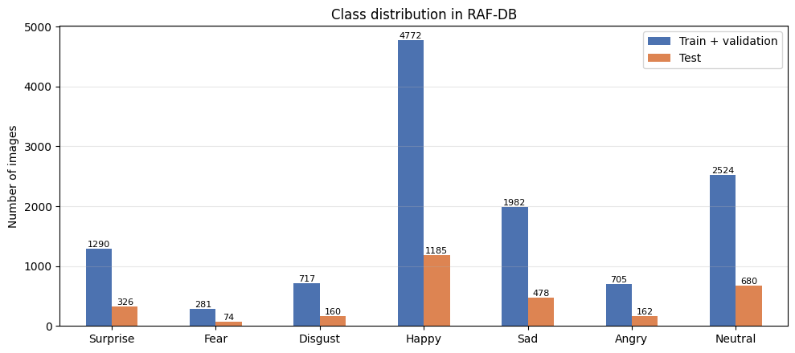
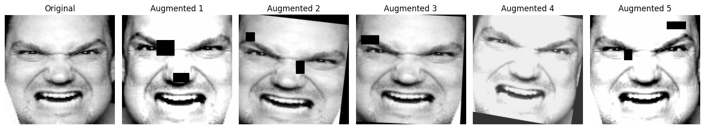
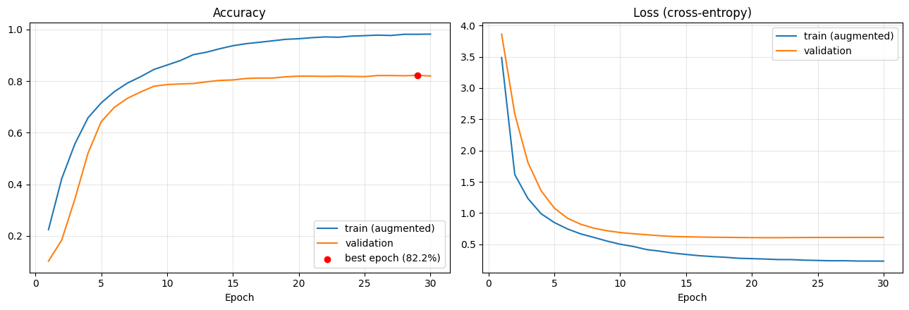
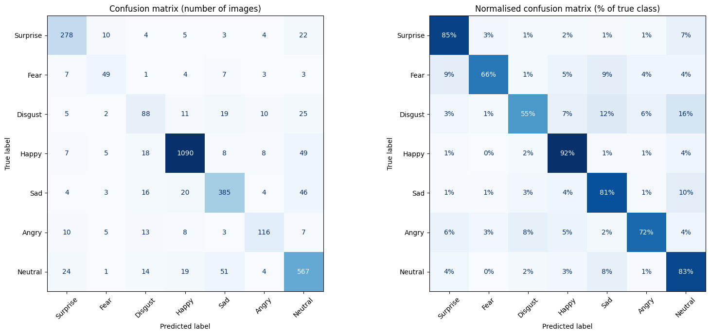
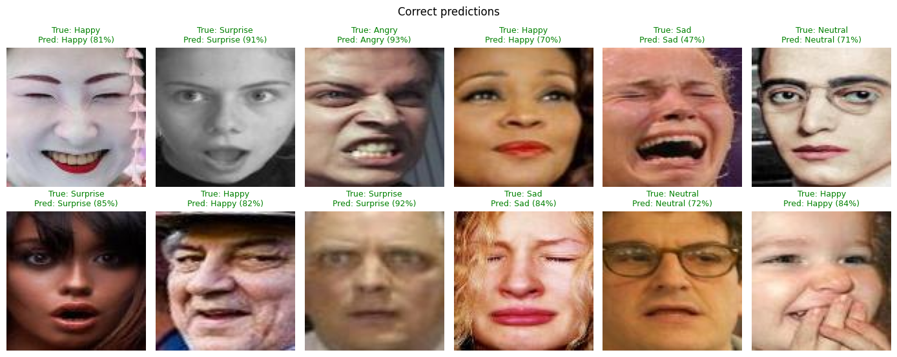
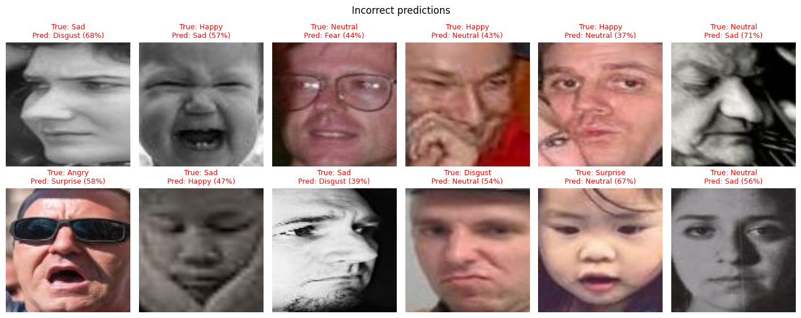

# Facial Emotion Recognition on RAF-DB

[](https://colab.research.google.com/github/mifolotech/rafdb-emotion-recognition/blob/main/RAFDB_Emotion_Recognition.ipynb)


**English** | [Français](README.fr.md)

Classification of real-world facial expressions into **7 emotions** with an **EfficientNet-B2** pre-trained on ImageNet and fine-tuned on the RAF-DB dataset.

**Test accuracy: 83.95%** · Macro F1-score: 0.765 · Weighted F1-score: 0.840

> Project carried out for the Machine Learning course of the B.Sc. in Computer Systems and Software Engineering, Jesuit University of Abidjan (CERAP), Côte d'Ivoire.

---

## Table of contents
1. [Problem](#1-problem)
2. [Dataset](#2-dataset)
3. [Preprocessing](#3-preprocessing)
4. [Model architecture](#4-model-architecture)
5. [Training and hyperparameters](#5-training-and-hyperparameters)
6. [Results](#6-results)
7. [Error analysis](#7-error-analysis)
8. [Limitations](#8-limitations)
9. [How to run](#9-how-to-run)
10. [Repository structure](#10-repository-structure)
11. [What I learned](#11-what-i-learned)
12. [References](#12-references)

---

## 1. Problem

Recognising emotions from facial expressions is a building block for human–computer interaction, assistive technologies and affective computing.

**Task:** given an aligned **colour image** of a face, predict one of 7 emotions: *Surprise, Fear, Disgust, Happy, Sad, Angry, Neutral*.

This is difficult because the photos are taken "in the wild" (varied ages, head poses, lighting, glasses, hands in front of the face), and some emotions look very similar (e.g. *Fear* and *Surprise*).

## 2. Dataset

**RAF-DB** (Real-world Affective Faces Database, Li et al., 2017): face images collected from the Internet, each labelled by about 40 annotators. The basic-emotion subset is used, with its official train/test split.

| Split | Images | Use |
|---|---|---|
| Train | 11,043 | Training (90% of the official `train/` folder) |
| Validation | 1,228 | Model selection and early stopping (10%, stratified) |
| Test | 3,065 | Final evaluation only (official `test/` folder) |

The dataset is **imbalanced**: *Happy* has 4,772 training images, while *Fear* has only 281.



The dataset is not included in this repository: RAF-DB is distributed by its authors (Pattern Recognition & Intelligent System Laboratory, Beijing University of Posts and Telecommunications) for **non-commercial research use only**. The original project page is no longer online; the contact address given in the paper is `whdeng@bupt.edu.cn` (see [How to run](#9-how-to-run)).

## 3. Preprocessing

1. Images are read in **RGB** and **resized** from 100×100 to 224×224 pixels.
2. **Normalisation** with the ImageNet mean and standard deviation, as expected by the pre-trained backbone.
3. **Data augmentation** (training only): random resized crop, horizontal flip, small rotations and shifts, colour jitter, occasional grayscale and **random erasing** (black rectangles that hide part of the face).



## 4. Model architecture

Transfer learning from an **EfficientNet-B2** pre-trained on ImageNet (library `timm`):

```
Input 224×224×3
 → EfficientNet-B2 (ImageNet weights), stochastic depth 0.2
 → Global average pooling (1408 features)
 → Dropout 0.3
 → Linear 1408 → 7
```

EfficientNet scales the depth, width and input resolution of the network together, which gives a good accuracy for its size (7.7 million parameters).

## 5. Training and hyperparameters

The whole network is fine-tuned, with **two learning rates**: the new classifier learns fast, while the pre-trained backbone is only gently adjusted.

Regularisation techniques used to limit overfitting:
- **Random erasing**: hides random rectangles of the face.
- **Label smoothing**: softens the targets so the model does not become over-confident.
- **Class-balanced loss**: rare classes get a higher weight, $\sqrt{N / (K \cdot n_c)}$.
- **Dropout and stochastic depth**: randomly switch off neurons and whole blocks during training.
- **EMA of the weights**: validation and predictions use a moving average of the weights.
- **Early stopping**: training stops if validation accuracy does not improve for 7 epochs.

| Hyperparameter | Value |
|---|---|
| Input size | 224×224×3 |
| Batch size | 64 |
| Epochs | 30 (early stopping, patience 7) |
| Optimiser | AdamW, weight decay = 0.05 |
| Learning rate | backbone 2e-4, classifier 1e-3 |
| Learning-rate schedule | 2 epochs linear warm-up, then cosine decay to 1% |
| Random erasing | probability 0.5, 1 to 3 rectangles of 16–40 px |
| Label smoothing | 0.1 |
| Dropout / stochastic depth | 0.3 / 0.2 |
| EMA decay | 0.998 |
| Model selection | best validation accuracy (epoch 29) |
| Test-time augmentation | 2 views (original, mirrored) |
| Precision | mixed float16, Google Colab T4 GPU (about 1 minute per epoch) |

## 6. Results

### Overall

| Metric | Test set |
|---|---|
| **Accuracy** | **83.95%** |
| Accuracy without test-time augmentation | 83.69% |
| Macro F1-score | 0.765 |
| Weighted F1-score | 0.840 |

### Per class

| Emotion | Precision | Recall | F1-score | Test images |
|---|---|---|---|---|
| Surprise | 0.830 | 0.853 | 0.841 | 326 |
| Fear | 0.653 | 0.662 | 0.658 | 74 |
| Disgust | 0.571 | 0.550 | 0.561 | 160 |
| Happy | 0.942 | 0.920 | 0.931 | 1,185 |
| Sad | 0.809 | 0.805 | 0.807 | 478 |
| Angry | 0.779 | 0.716 | 0.746 | 162 |
| Neutral | 0.789 | 0.834 | 0.811 | 680 |

*Happy* and *Surprise* are recognised best: their expressions are very distinctive (smile; open mouth and raised eyebrows). *Disgust* is the hardest class: it has few examples and is often expressed subtly.

### Learning curves



- The training curve is computed on augmented images with dropout active, the validation curve on real images with the EMA weights.
- The **validation loss decreases, then stays flat (about 0.61)**: it does not go back up, so the model does not become over-confident.
- Validation accuracy reaches about 80% at epoch 15, then stabilises around 82%, while training accuracy keeps rising towards 98%. The **gap of about 16 points** shows that the model still memorises part of the training set (**overfitting**). The weights of the best epoch (29, validation accuracy 82.2%) are the ones kept.

### Confusion matrix



### Comparison with a first version

A first version of this project (plain cross-entropy, light augmentation, 15 epochs) reached **84.08%** test accuracy, with a similar gap between training and validation accuracy and a validation loss that rose after epoch 3. The regularisation techniques of this version **did not improve the accuracy** (83.95%) and **did not reduce the accuracy gap**, but they stopped the validation loss from rising. This version also adds the macro F1-score, a reproducible pipeline and an error analysis.

## 7. Error analysis

Most frequent confusions on the test set:

| True emotion | Predicted as | Rate | Images |
|---|---|---|---|
| Disgust | Neutral | 15.6% | 25 |
| Disgust | Sad | 11.9% | 19 |
| Sad | Neutral | 9.6% | 46 |
| Fear | Surprise | 9.5% | 7 |
| Fear | Sad | 9.5% | 7 |

*Neutral* attracts most errors: a slight *Disgust* or *Sad* expression is often read as no emotion at all. *Fear* and *Surprise* both involve wide-open eyes and an open mouth.

**Correct predictions**



**Incorrect predictions**



Many incorrect predictions are on difficult images: occlusions (sunglasses, hands), strong head rotations, dark or grayscale photos, and faces that are ambiguous even for a human.

## 8. Limitations

- **Overfitting**: a gap of about 16 points remains between training and validation accuracy. Adding regularisation did not reduce it.
- **Class imbalance**: *Fear* has only 281 training images and 74 test images, so its results are less reliable than for large classes.
- **Similar emotions**: *Disgust*, *Sad* and *Neutral*, as well as *Fear* and *Surprise*, are often confused with each other.
- **Ambiguous labels**: real faces often mix several emotions; even human annotators disagree on some images.
- **Aligned faces only**: the model has no face detector; a photo must first be cropped and aligned around the face.
- **Single training run**: results come from one run with a fixed seed. Variance across several runs was not measured.
- **Static images only**: the model was not tested on real-time video or on faces from other datasets, so its generalisation to other conditions is unknown.
- **Ethical note**: a facial expression does not always reflect a person's real emotional state, and recognition performance can vary across populations. This model is an educational project and should not be used for decisions about people.

**Possible improvements:** Mixup or CutMix (which directly target memorisation of the training set), a larger or face-specific backbone, and several runs with different seeds to report a mean and a standard deviation.

## 9. How to run

The easiest way is Google Colab:

1. Request RAF-DB from its authors (see [Dataset](#2-dataset)) and create `RAFDB.zip` containing the folders `train/1 … train/7` and `test/1 … test/7`.
2. Put `RAFDB.zip` in your Google Drive, in `MyDrive/Machine Learning/Emotion Recognition RAF DB/` (or change `DATA_SOURCE` in Section 1 of the notebook).
3. Open the notebook with the **Open in Colab** badge above.
4. Select *Runtime → Change runtime type → T4 GPU*, then *Runtime → Run all*.

Training is saved on Drive after every epoch and resumes automatically if Colab disconnects. The notebook also runs on **Kaggle** (RAF-DB added as a private dataset, *GPU T4* and *Internet* enabled): it detects the platform automatically.

**Use the trained model without retraining:** download `best_model.pth` from the [Releases](https://github.com/mifolotech/rafdb-emotion-recognition/releases) page and place it in the `outputs/` sub-folder of the Drive folder above, together with `results/history.csv`. Create an empty file named `training.done` next to them and run the notebook. It will skip training and go directly to evaluation.

To run locally, install the dependencies with:

```bash
pip install -r requirements.txt
```

## 10. Repository structure

```
rafdb-emotion-recognition/
├── RAFDB_Emotion_Recognition.ipynb   # Full notebook: data, model, training, evaluation
├── README.md                         # English version
├── README.fr.md                      # French version
├── requirements.txt
├── LICENSE
├── results/
│   ├── history.csv                   # Training history (accuracy and loss per epoch)
│   └── results.json                  # Test metrics
└── figures/
    ├── class_distribution.png
    ├── augmentation_examples.png
    ├── learning_curves.png
    ├── confusion_matrix.png
    ├── examples_correct.png
    └── examples_errors.png
```

## 11. What I learned

- Applying **transfer learning** with two learning rates, so that the pre-trained features are only gently adjusted while the new classifier learns fast.
- **Reading learning curves**: the accuracy curves and the loss curves can tell different stories. Here the validation loss stopped rising, but the accuracy gap remained.
- **Regularisation is not guaranteed to help**: adding several techniques at once did not improve the accuracy. Reporting this honestly is part of a good experiment, and the next step is to test one technique at a time.
- Handling **class imbalance** with a weighted loss and evaluating it with per-class metrics and the macro F1-score, not only accuracy.
- Keeping a **clean evaluation protocol**: a validation set for model selection and a test set used only once at the end.
- Making experiments **reproducible** (fixed seeds, saved history, automatic resume) and **respecting a dataset licence** (RAF-DB is not redistributed).

## 12. References

- Li, S., Deng, W., Du, J. (2017). *Reliable Crowdsourcing and Deep Locality-Preserving Learning for Expression Recognition in the Wild*. CVPR (RAF-DB). [Paper](https://openaccess.thecvf.com/content_cvpr_2017/papers/Li_Reliable_Crowdsourcing_and_CVPR_2017_paper.pdf)
- Tan, M., Le, Q. V. (2019). *EfficientNet: Rethinking Model Scaling for Convolutional Neural Networks*. ICML.
- Huang, G., Sun, Y., Liu, Z., Sedra, D., Weinberger, K. Q. (2016). *Deep Networks with Stochastic Depth*. ECCV.
- Zhong, Z., Zheng, L., Kang, G., Li, S., Yang, Y. (2020). *Random Erasing Data Augmentation*. AAAI.
- Szegedy, C. et al. (2016). *Rethinking the Inception Architecture for Computer Vision*. CVPR (label smoothing).
- Loshchilov, I., Hutter, F. (2019). *Decoupled Weight Decay Regularization*. ICLR (AdamW).
- Wightman, R. (2019). *PyTorch Image Models (timm)*. GitHub repository.

---

**Author:** Yéo Mifolo Elisée · [GitHub @mifolotech](https://github.com/mifolotech) · mifolo.tech@gmail.com

This project is released under the [MIT License](LICENSE).
